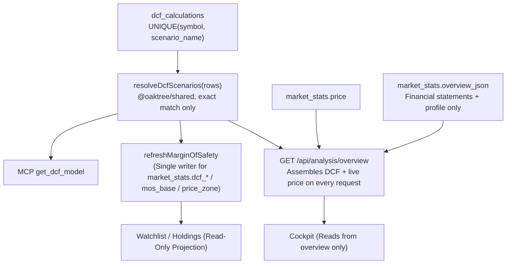

# 17. Single Source of Truth (SSOT) Architecture and Domain Decoupling

Date: 2026-10-25
Status: Accepted (Amends ADR-0014)

## Context

As the Oaktree platform expanded with multi-agent research (Bull vs. Bear Debate), AI-assisted DCF valuations, and portfolio risk sizing, several subtle "split-brain" data synchronization anomalies emerged across the system:

1. **Stale DCF Scenarios inside Frozen Financial Overview Cache**:
   - The financial overview service cached historical statements from Finnhub/Yahoo into `market_stats.overview_json` for 6 hours.
   - A snapshot of `dcfScenarios` and `currentPrice` was historically embedded directly inside this 6-hour JSON blob.
   - When users updated DCF assumptions in the web UI, or when Gemini saved 3 scenarios via MCP (`save_dcf_scenarios`), the raw `dcf_calculations` table was updated immediately, but `market_stats.overview_json` remained frozen.
   - Consequently, newly evaluated stocks (such as `RDDT`) had full valuation data in the DCF Model tab, but showed blank dashes (`—`) in the Cockpit's Quadrant A card.

2. **Duplicated & Stale Margin of Safety (MoS %) Ratios**:
   - The Margin of Safety metric was calculated and stored in `market_stats.mos_base_pct`, embedded in `overview_json`, and simultaneously computed client-side in `@oaktree/shared`.
   - Any intraday price change or DCF re-run created split-brain states where the Watchlist chip, Cockpit badge, and DCF Model displayed differing percentages.

## Out of Scope

- **Theme & Sector Mappings**: Thematic mappings (`theme_symbol_mappings` vs `watchlist.sector_label`) are decoupled by design and `watchlist` does not maintain a diverging `theme_name` column. No operational divergence was identified in production.

## Decision

Following the architectural review, we establish a **Clean Domain Separation & Pure Single Source of Truth (SSOT)** model:

### 1. Strict Domain Demarcation (Database Layer)
- **`dcf_calculations`** is the **sole authoritative owner** of all valuation metrics (`implied_share_price`, `wacc`, `terminal_growth`, scenario assumptions).
- **`market_stats`** is the **sole authoritative owner** of market pricing (`price`, `market_cap`, `fifty_two_week_high/low`).
- **`overview_json` Payload Hygiene**: `overview_json` is strictly restricted to caching external multi-period financial statements (`quarterly`, `annual`, `companyStatistics`). No DCF scenarios or market prices may be permanently stored inside this JSON string.
- **`stock_fundamentals`** is the **sole authoritative owner** of qualitative business profiles and dialectical debate transcripts.

### 2. Handler-Level Dynamic Composition (Zero UI Breaking Changes)
- Rather than forcing frontend clients to execute fragmented network requests, `GET /api/analysis/overview` dynamically assembles the response at the backend handler:
  - Financial statements are retrieved from the 6-hour cache (`overview_json`).
  - Active DCF scenarios (`base`, `bear`, `bull`, `wacc`, `terminalGrowth`) are queried live from `dcf_calculations` using the shared exact resolver `resolveDcfScenarios`.
  - Current market price is queried live from `market_stats.price`.
- Clients always receive fully synchronized, zero-latency payloads without schema or contract breaks.

### 3. Single-Writer Projection for Margin of Safety (Amends ADR-0014)
- Margin of Safety columns in `market_stats` (`dcf_bear`, `dcf_base`, `dcf_bull`, `mos_base`, `price_zone`) serve as a read-only projection cache for fast Watchlist and Portfolio table queries.
- `refreshMarginOfSafety` in `@oaktree/shared` is established as the **single authoritative writer** for these projection columns, utilizing `resolveDcfScenarios` so its resolution logic is 100% identical to `overview`.
- Detailed interactive UI views (e.g. Cockpit, DCF Model) compute real-time values on fresh inputs using `computeMarginOfSafety` with the identical mathematical formula.

### 4. Canonical Scenario Resolution & Unique Constraints
- **Exact Preset Matching**: The resolver strictly matches canonical scenario presets (`Base Case`, `Bear Case`, `Bull Case`). No loose fuzzy matching or arbitrary `rows[0]` fallback.
- **Database Level Uniqueness**: A unique index `ux_dcf_symbol_scenario` on `dcf_calculations(symbol, scenario_name)` guarantees at most 3 rows per symbol.
- **Remount Isolation**: `AnalysisReport.tsx` enforces `key={symbol}` on `<StockDossierCockpit key={symbol} />`, preventing state leakage when switching tickers.

## Consequences

- **Positive**:
  - **Zero Split-Brain**: DCF runs saved via Web UI or Gemini MCP immediately reflect across Cockpit, Watchlist, and DCF tabs without cache delay.
  - **Clean Architectural Boundaries**: Clear separation between cached external statements and real-time internal calculations.
  - **No UI Regressions**: Handlers maintain API backwards compatibility for existing consumers.
  - **Data Integrity**: Canonical naming and unique index prevent duplicate scenario entries.
- **Negative / Considerations**:
  - `GET /api/analysis/overview` performs a lightweight local D1 query on cached hits to attach live DCF data, rather than returning raw JSON directly.
