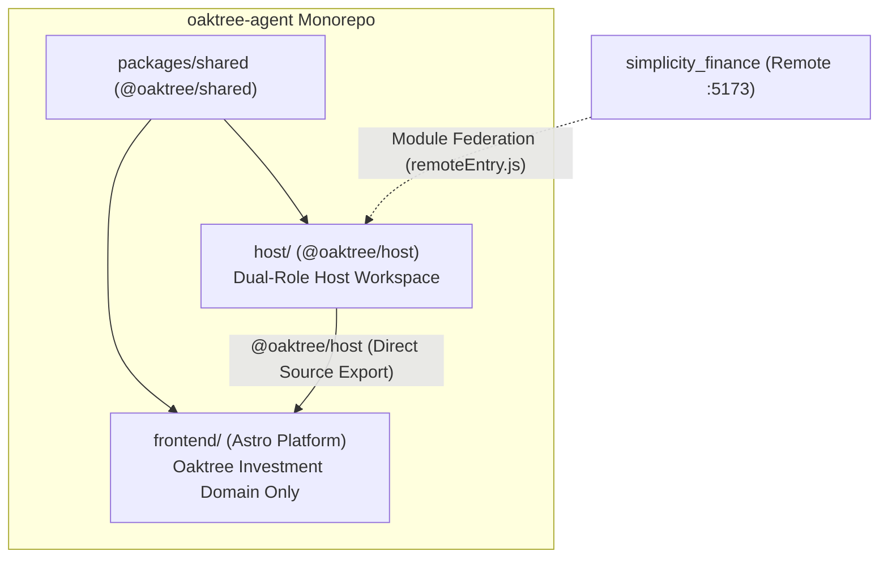

# 19. Standalone Host Workspace and Shell Extraction

Date: 2026-11-01
Status: Accepted (Complements ADR-0017)

## Context

Prior to this architectural evolution, the entire host application shell—including authentication interception, Google OAuth callback exchange, TanStack Router tree definition, theme management, Header UI, Sidebar UI, and the Module Federation dynamic remote loader (`RemoteFinanceContainer`)—resided directly inside the `frontend` workspace (`frontend/src/`).

This architecture created significant developer experience and decoupling bottlenecks:
1. **Coupled Developer Workflow**: Testing independent remote modules (such as `simplicity_finance` in `brave-planck`) required starting the entire Astro frontend application along with its substantial dependency bundle (Workers AI SDK, heavy charts, WASM fallbacks, and comprehensive market intelligence modules).
2. **Duplicated Shell Maintenance**: Any intent to build a lightweight test harness risked duplicating navigation, header actions, wallet synchronization, and auth token injection logic.
3. **Monorepo Cohesion**: The repository already utilizes NPM Workspaces and Turborepo with `@oaktree/shared`. The host shell logic naturally constitutes a shared capability between the development test harness and production platform deployment.

## Decision

We establish a **Dual-Role Host Workspace** (`host/` — `@oaktree/host`) with clean domain separation:



### 1. Dual-Role Host Workspace Architecture
- **Role A (Standalone Vite + React SPA App)**:
  `host/` contains its own `index.html` and `vite.config.ts` running on port `4321`. Running `npm run dev:host` starts a lightweight, millisecond-fast development server with the full Header UI, Auth, and Module Federation bridge active.
- **Role B (Authoritative Shell Package)**:
  `host/package.json` declares direct TypeScript source export (`"exports": { ".": "./src/index.ts" }`). When `frontend/` runs in Astro/Vite, it consumes `<HostAppShell />` from `@oaktree/host` directly with zero build lag and instant Hot Module Replacement (HMR).

### 2. View Slot Injection Pattern
- `HostAppShell` provides the full application skeleton (Auth interceptors, TanStack Router tree, ThemeProvider, Header, Sidebar).
- Domain-specific views are injected as optional component slots (`OaktreeFeatureViews`):
  ```tsx
  <HostAppShell
    views={{
      dashboard: YahooPortfolio,
      market: MarketIntelligence,
      watchlist: Watchlist,
      agent: KnowledgeChat,
      analysis: AnalysisReport,
      dbAgent: DatabaseChat,
      commandCenter: SourceManager,
    }}
    reportsCount={reportsCount}
  />
  ```
- When running in **Standalone Host Mode** without injected domain views, opening an Oaktree route renders the **Standalone Host Inspector Card**, displaying active route state and providing a one-click shortcut to test `simplicity_finance` (`/finance`).

### 3. Clean Deletion from `frontend/src/`
- All shell components (`Header.tsx`, `Sidebar.tsx`, `RoutesLayout.tsx`, `RemoteFinanceContainer.tsx`, `FederatedErrorBoundary.tsx`, `LoginScreen.tsx`, `ThemeProvider.tsx`, and `financeBridgeStore.ts`) along with their adversarial test suites are permanently relocated to `host/src/` and deleted from `frontend/src/`.
- Cross-cutting primitives (`AuthContext.tsx`, `OaktreeIcon.tsx`, `NotFoundPage.tsx`, `settingsStore.ts`, `glass.ts`) in `frontend/src/` become clean, 1-line re-export bridges to `@oaktree/host`.

### 4. Side-Effect-Free Route Schemas & Interceptor Guard
- Zod search schemas (`financeSearchSchema`, `analysisSearchSchema`, `generalSearchSchema`) are segregated into `host/src/router/schemas.ts` to allow testing query parameters without triggering network interceptors.
- `installAuthFetchInterceptor()` guards against multiple invocations during Vite HMR using `window.__oaktreeFetchIntercepted`.

## Consequences

- **Positive**:
  - Developers can test `simplicity_finance` and future federated micro-frontends instantly with `npm run dev:host` without booting the heavy investment frontend.
  - Single Source of Truth: Header UI, Auth, Theme, and Federation logic exist in exactly one location.
  - Production deployments of `frontend` via Cloudflare Pages remain 100% backward compatible.
  - 0ms HMR across both workspaces during local development.
- **Negative / Considerations**:
  - Root `npm run build` and CI pipelines now orchestrate an additional workspace (`@oaktree/host`).

