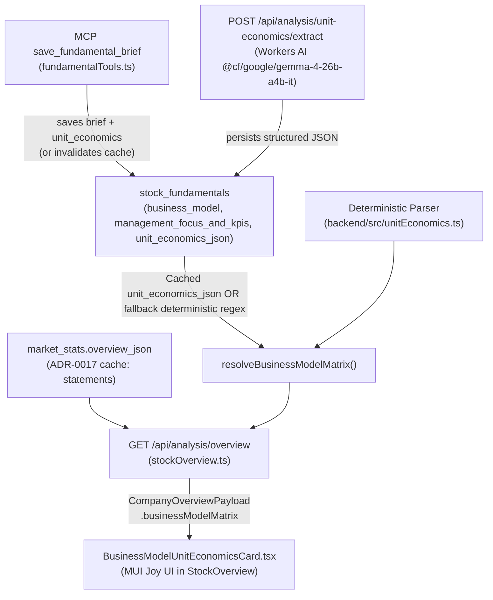

# 20. Business Model & Unit Economics Matrix Visualization and Dynamic Extraction

Date: 2026-11-05  
Status: Accepted (Complements ADR-0012, ADR-0017)

## Context

In the Stock Dossier's Overview tab (introduced in ADR-0012), users had access to consolidated multi-period financial bar charts (Revenues, Gross Profit, Operating Profit, Cash from Operations, Free Cash Flow) sourced from Yahoo Finance and Finnhub. While consolidated statements show aggregate top-line and bottom-line health, they do not explain **how** the company generates its revenue or which underlying unit economic engines drive long-term moat expansion.

For instance, looking at Shopify (`SHOP`):
- Consolidated revenue alone obscures the structural divide between **Subscription Solutions** (high gross margin ~80%, sticky MRR) and **Merchant Solutions** (78% share, driven by GMV payments, attach rate, and Merchant Solutions take rate).
- Different business archetypes (e.g. E-Commerce Platforms, Ad-driven Big Tech, Cloud B2B SaaS, Crypto Exchanges, Semiconductor IP) monitor fundamentally distinct unit economic matrices (e.g., GMV vs. Ad Impressions vs. RPO vs. MTUs vs. Royalty Units).
- While qualitative notes existed in `stock_fundamentals` (`business_model`, `management_focus_and_kpis`), they were rendered as plain unstructured text blocks, forcing users to read paragraphs rather than inspecting visual segment proportions and unit economics KPIs at a glance.

## Out of Scope

- **Hardcoded Company Templates**: We do not create static, company-specific schemas (e.g., an ad-only schema or e-commerce-only schema). The matrix is dynamically polymorphic across archetypes.
- **Third-Party Heavy Chart Libraries**: No bulky external SVG or Canvas dependencies (Chart.js, Recharts, D3); all visualizations use lightweight SVG and native MUI Joy UI primitives.

## Decision

We establish an end-to-end subsystem for structured **Business Model & Unit Economics Matrix** extraction, caching, and visualization:

### 1. Database Schema Extension (Migration 0047)
A nullable text column `unit_economics_json` was added to `stock_fundamentals` via migration `0047_add_unit_economics_to_stock_fundamentals.sql`:
- Stores verified, structured JSON payloads representing `BusinessModelMatrix`.
- Indexed and queried alongside fundamental briefs.

### 2. Payload Hygiene & ADR-0017 Compliance
Following ADR-0017:
- `market_stats.overview_json` remains an immutable 6-hour cache dedicated solely to multi-period statements from Yahoo/Finnhub.
- `stock_fundamentals` is the authoritative owner of the business model and unit economics matrix.
- `GET /api/analysis/overview` uses handler-level dynamic composition (`attachLiveValuation`) to inject `businessModelMatrix` into `CompanyOverviewPayload` on every request.

### 3. Dual-Layer Hybrid Parsing Architecture
To guarantee zero latency for all existing stocks while enabling deep AI extraction:
1. **Deterministic Fast Path (Zero-Latency Fallback)**:
   - `backend/src/unitEconomics.ts` contains a pure TypeScript parser (`parseBusinessModelMatrixFromBrief`).
   - Uses regex to parse segment names, revenue percentages, growth rates, and margins from existing brief text (`business_model`).
   - Parses hero KPI metrics from `management_focus_and_kpis`.
   - **Implied Segment Revenue Calculation**: When a company provides segment proportions (%) but not absolute dollar figures, the parser infers dollar revenues (`$M`) from the latest quarterly total revenue (`enrichSegmentsWithImpliedRevenue`) and flags them with `isImpliedRevenue: true`.
2. **Workers AI Deep Extraction**:
   - `POST /api/analysis/unit-economics/extract` invokes `@cf/google/gemma-4-26b-a4b-it`.
   - Structures ambiguous notes into the canonical `BusinessModelMatrix` schema and persists to `stock_fundamentals.unit_economics_json`.
3. **MCP Tool Synchronous Invalidation**:
   - `save_fundamental_brief` accepts optional `unit_economics`. When a new brief is pushed without `unit_economics`, it sets `unit_economics_json = NULL`, ensuring stale quarter data is immediately discarded.

### 4. Frontend UI Standardization (MUI Joy UI)
Implemented in `BusinessModelUnitEconomicsCard.tsx`:
- **100% Proportional Stacked Segment Bar**: Visually displays revenue contribution with custom theme-safe colors and hover tooltips.
- **Segment Breakdown Cards**: Show share %, dollar revenue ($M), YoY growth badge with directional arrows, and operating/gross margin badges.
- **Unit Economics Bento Grid**: Displays company-specific KPIs (e.g. GMV, Attach Rate, MRR, RPO) with contextual sub-labels and miniature progress gauge indicators.
- **Interactive Deep Extract & Prompt Copy**: One-click AI extraction trigger and prompt modal for external Gemini LLM analysis.

## Consequences

### Positive
- **Instant Usability**: Every stock with an existing fundamental brief immediately gains a visual Business Model & Unit Economics breakdown without requiring manual migration or database rewrites.
- **Domain Decoupling**: Fully adheres to ADR-0017; no risk of stale financial statements cache corrupting unit economics data.
- **Extensible Archetypes**: Naturally adapts to any industry (E-Commerce, Big Tech, Ad Tech, SaaS, Industrial) without schema changes.

### Neutral / Trade-offs
- Deterministic regex parsing relies on standard formatting conventions in fundamental briefs; unformatted text will yield partial segments, which can then be refined via the Workers AI extract button or Gemini prompt modal.

