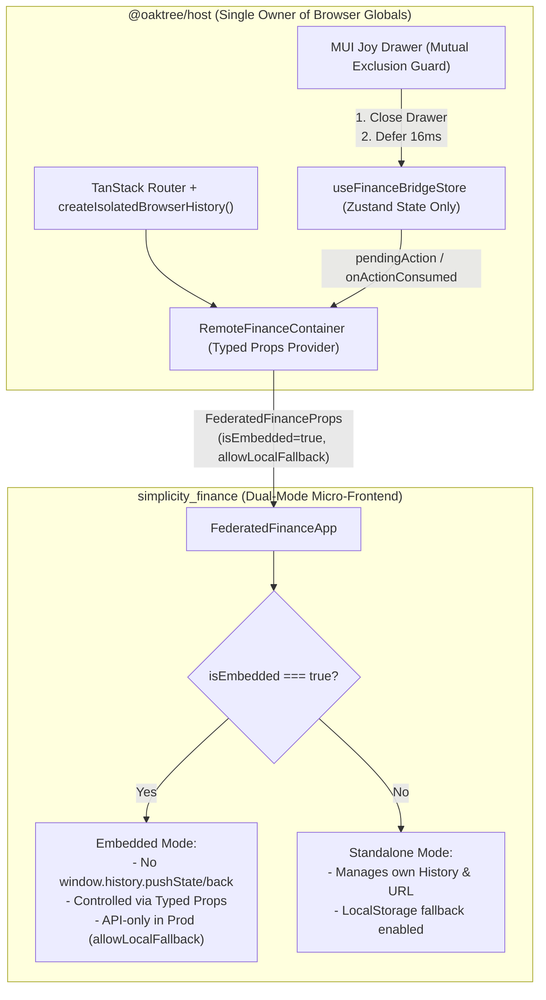

# 21. Federated Micro-Frontend Boundary and Host-Controlled Contract

Date: 2026-11-07
Status: Accepted (Extends ADR-0017 & ADR-0019)

## Context

Following the extraction of `@oaktree/host` in ADR-0019, the Oaktree Host Shell and the `simplicity_finance` remote micro-frontend operated with overlapping ownership of browser globals (`window.history`, `window` CustomEvents, `localStorage`, and `document.body` scroll/focus locks) because both projects originated as standalone applications.

This overlapping ownership caused critical runtime conflicts:
1. **Browser History Collision & Infinite Render Loops**:
   - `@oaktree/host` uses `@tanstack/react-router`, which monkey-patches `window.history.pushState`/`replaceState` and subscribes to `popstate` as a single global owner.
   - `simplicity_finance` mounted `<MobileTransactionView />` on mobile viewports and directly invoked `window.history.pushState({ simplicityView: 'mobile-tx' }, '')` and `window.history.back()` inside a `useEffect` with an unmemoized `[closeForm]` dependency.
   - Each `pushState` triggered a TanStack Router notification -> `RoutesLayout` re-render -> `RemoteFinanceContainer` re-render -> new `closeForm` reference -> effect cleanup (`history.back()`) -> `popstate` -> infinite synchronous loop that froze the browser main thread.
2. **Dual-Channel State & Action Ambiguity**:
   - Cross-application communication mixed React props (`activeTab`, `selectedWalletId`) with imperative global `window.dispatchEvent(new CustomEvent('oaktree:finance-action'))` and `oaktree:wallets-synced` events, requiring multi-layer echo-prevention refs.
3. **UI Overlay & Z-Index Collisions**:
   - Host uses **MUI Joy UI** (`<Drawer>`, `<Modal>` at `z-index: 1300–1301`), whereas Simplicity uses **Tailwind CSS + Radix UI** (`<Dialog>` and mobile fullscreen views at `z-[10000]`). Simultaneous drawer closing and remote modal mounting caused focus-trap and scroll-lock contention.
4. **Uncontrolled Production Fallback**:
   - Simplicity automatically fell back to `localStorage` / `IndexedDB` (`simplicity_wallets`, `simplicity_transactions`) whenever an API request failed, risking silent stale/local data display in production.

## Decision

We establish a strict **Host-Controlled Federated Boundary Contract** while preserving **Standalone Mode** capability for `simplicity_finance`:



### 1. Single Ownership of Browser History & Dual-Mode Flag (`isEmbedded`)
- `@oaktree/host` is the **sole owner** of `window.history` and the URL bar when running in federated mode.
- `RemoteFinanceContainer` passes `isEmbedded={true}` to `FederatedFinanceApp`.
- **In Embedded Mode (`isEmbedded === true`)**:
  - The remote micro-frontend **MUST NOT** call `window.history.pushState`, `window.history.replaceState`, or `window.history.back()` directly for internal UI states (such as `MobileTransactionView`).
  - As a defense-in-depth safety net, `@oaktree/host` wraps TanStack Router's history with `createIsolatedBrowserHistory()`, which deduplicates consecutive modal states and suppresses router subscriber notifications when `pathname + search + hash` has not changed.
- **In Standalone Mode (`isEmbedded === false | undefined`)**:
  - `simplicity_finance` retains full control of its own routing and mobile back-button history stack.

### 2. Hard Cutover to Typed Props Contract (Zero CustomEvents)
- All global `window.dispatchEvent(new CustomEvent('oaktree:...'))` calls and listeners are removed in favor of a pure **Typed Props Contract** (`FederatedFinanceProps`):
  ```ts
  export interface FederatedFinanceProps {
    user?: any;
    token?: string | null;
    theme?: 'light' | 'dark';
    usdThbRate?: number;
    isEmbedded?: boolean;
    allowLocalFallback?: boolean;
    activeTab?: FinanceTab;
    selectedWalletId?: string;
    pendingAction?: FinanceActionType | null;
    onActionConsumed?: () => void;
    onTabChange?: (tab: FinanceTab) => void;
    onWalletChange?: (walletId: string) => void;
    onWalletsSync?: (wallets: Wallet[]) => void;
    apiBaseUrl?: string;
  }
  ```
- Host URL search parameters (`?tab=<FinanceTab>&wallet=<walletId>`) are the **Single Source of Truth** for navigation state.
- When a user triggers a Quick Action (`add-tx`, `ai-scan`, `csv-import`, `add-wallet`) from the Host Header or Mobile Drawer, `dispatchFinanceAction(action)` updates `pendingAction` in `useFinanceBridgeStore`.
- `RemoteFinanceContainer` passes `pendingAction` and `onActionConsumed` directly as React props to `<FederatedComponent />`. Once the remote opens the target modal, it invokes `onActionConsumed()` to clear the action.

### 3. Overlay Mutual Exclusion & Z-Index Tiering
- Host and Remote overlays obey **Mutual Exclusion**: when an action is triggered from the Host Mobile Drawer, the Drawer closes first (`onClose()`) and defers action state propagation by one animation frame (`16ms`) so MUI Joy UI releases its focus trap and `body` scroll lock before the Remote modal mounts.
- Standardized CSS custom property Z-Index tiers are established on `:root`:
  - `--oaktree-z-header: 1100`
  - `--oaktree-z-drawer: 1300`
  - `--oaktree-z-host-modal: 1350`
  - `--oaktree-z-remote-modal: 1400`

### 4. Host-Governed Environment & Offline Fallback (`allowLocalFallback`)
- `RemoteFinanceContainer` passes `allowLocalFallback={isLocalEnvironment()}` to `FederatedFinanceApp`.
- **Production (`allowLocalFallback === false`)**: Simplicity strictly queries the production API (`apiBaseUrl`) using the Host-supplied JWT `token` and never silently falls back to `localStorage`.
- **Local Development (`allowLocalFallback === true`)**: Host seeds a default `Cash` wallet (`wal_cash`) if `localStorage.getItem('simplicity_wallets')` is empty, and Simplicity is permitted to fall back to `localStorage` when the local backend is offline.

## Consequences

- **Positive**:
  - Eliminates infinite `pushState` / `popstate` loops and browser freezes on mobile devices.
  - Removes untyped global `window` CustomEvents in favor of compile-time checked React props.
  - Preserves 100% standalone capability for `simplicity_finance` when developed or deployed independently.
  - Prevents production users from seeing stale or phantom `localStorage` fallback data during transient network errors.
- **Negative / Considerations**:
  - Requires a synchronized update in the `simplicity_finance` repository to consume `isEmbedded`, `allowLocalFallback`, `pendingAction`, and `onActionConsumed` props.
