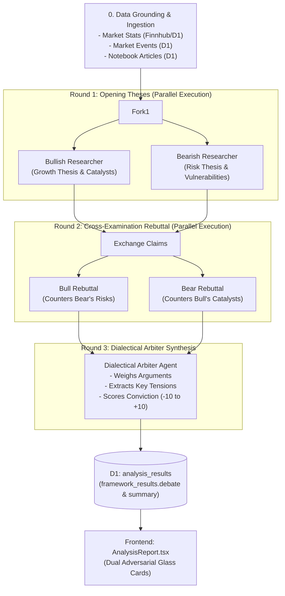

# 🐂 vs 🐻 Bull vs. Bear Dialectical Debate Specification (Phase 1)
**Oaktree Multi-Agent Feature**  
*Document Status: Approved Architecture Plan (Post-Grilling)*  
*Design Inspiration: TauricResearch/TradingAgents Multi-Agent Framework*

---

## 1. 🎯 Objectives & Design Philosophy

การวิเคราะห์หุ้นโดยทั่วไปมักประสบปัญหา **Confirmation Bias** เมื่อนักลงทุนหรือ AI มีมุมมองโน้มเอียงไปทางบวก (Bullish) หรือทางลบ (Bearish) ก็จะมองหาเฉพาะเหตุผลที่สนับสนุนมุมมองเดิมของตนเอง

ระบบ **Bull vs. Bear Dialectical Debate Engine** นำรูปแบบการทำงานของ **TauricResearch/TradingAgents** มาประยุกต์ใช้เพื่อ:
1. **Adversarial Stress-Testing:** บังคับให้ AI สวม 2 บทบาทที่ตรงข้ามกันอย่างสิ้นเชิงเพื่อค้นหาข้อโต้แย้งที่แข็งแกร่งที่สุด
2. **Structured Dialectical Protocol:** ไม่ปล่อยให้คุยกันสะเปะสะปะ แต่แบ่งเป็นรอบที่ชัดเจน (Opening Thesis ➡️ Cross-Examination Rebuttal ➡️ Arbiter Synthesis)
3. **Multi-Modal Data Grounding:** ใช้ทั้ง **Quantitative Metrics** (งบการเงิน, อัตราส่วนทางการเงินจาก Finnhub/D1) และ **Qualitative Intelligence** (ข่าวสาร `market_events` และบทวิเคราะห์ `notebook_articles` ใน D1)
4. **Unified Investor Experience:** ฝังผลลัพธ์ลงในการ์ดสรุปภายในแท็บ **Report** ของ `AnalysisReport.tsx` เพื่อให้นักลงทุนเห็นทั้งมุมมองกูรูคุณค่า (Buffett, Munger ฯลฯ) และการปะทะกันแบบสองขั้วในหน้าจอเดียว

---

## 2. 📖 Domain Model & Glossary (TradingAgents Adaptation)

| คำศัพท์ / บทบาท | คำจำกัดความ | หน้าที่และขอบเขต |
|---|---|---|
| **Bullish Researcher** | Agent ฝั่งกระทิง (Optimistic Long) | ค้นหา Growth Catalysts, Pricing Power, การขยาย Moat, Operating Leverage, โอกาสขยายตลาดใหม่ และ Valuation Upside |
| **Bearish Researcher** | Agent ฝั่งหมี (Skeptical Short / Risk) | ค้นหา Inversion Risks, Margin Compression, หนี้สิน, กระแสเงินสดเสื่อมถอย, การถูก Disrupt, Valuation Stretch, และจุดตายของธุรกิจ |
| **Opening Thesis (Round 1)** | คำแถลงเปิดคดีของแต่ละฝ่าย | แต่ละฝ่ายสร้างสมมติฐานหลัก 3-5 ข้อ พร้อมหลักฐานตัวเลขและข่าวสารสนับสนุน |
| **Cross-Examination Rebuttal (Round 2)** | การซักค้านและแก้ต่าง | Bull โจมตีข้ออ้างของ Bear พร้อมเหตุผลหักล้าง; Bear โจมตีข้ออ้างของ Bull เพื่อชี้จุดอ่อน |
| **Dialectical Arbiter (Round 3)** | อนุญาโตตุลาการผู้ชี้ขาด | สรุปผลการประลอง, ระบุจุดที่ทั้งสองฝ่ายเห็นพ้อง (Consensus), ชี้จุดแตกหักชี้ขาด (Key Tensions), และประเมิน Conviction Balance |
| **Key Tensions** | จุดวัดใจชี้ขาด (Decisive Pivot Factors) | ข้อสมมติฐาน 1-3 ข้อที่ตลาดกำลังถกเถียงกัน และเป็นตัวตัดสินว่ามูลค่าหุ้นจะวิ่งไปทาง Bull หรือ Bear |
| **Conviction Score** | ดัชนีน้ำหนักความได้เปรียบ | คะแนนตั้งแต่ **-10 (Extreme Bear)** ถึง **+10 (Extreme Bull)** พร้อม Risk-Reward Ratio |

---

## 3. 🏗️ Architecture & Dialectical Debate Pipeline



### ⚡ Edge Performance & Cloudflare Worker Optimization
เพื่อป้องกันปัญหา Request Timeout และ Latency สูง:
- **Round 1:** รัน Bull และ Bear คู่ขนานกันด้วย `Promise.all([ runBull(), runBear() ])` (ใช้เวลา ~3-5s)
- **Round 2:** รัน Rebuttal คู่ขนานกันด้วย `Promise.all([ runBullRebuttal(), runBearRebuttal() ])` (ใช้เวลา ~3-5s)
- **Round 3:** Arbiter Synthesis รัน 1 ครั้ง (ใช้เวลา ~3-4s)
- **Total Latency:** ~10-14 วินาที สำหรับการโต้วาทีแบบ Full Dialectical 3 รอบ!

---

## 4. 🗄️ Database & Schema Integration

ข้อมูลผลการ Debate จะถูกผสานเข้ากับตาราง `analysis_results` เดิม เพื่อให้ Backward Compatible 100%:

### 1) ใน `analysis_results.framework_results`
เพิ่มฟิลด์ `debate`:
```json
{
  "peter_lynch": { ... },
  "hamilton_helmer": { ... },
  "warren_buffett": { ... },
  "charlie_munger": { ... },
  "howard_marks": { ... },
  "joel_greenblatt": { ... },
  "debate": {
    "round1": {
      "bull_thesis": "...",
      "bull_points": ["Catalyst 1...", "Catalyst 2..."],
      "bear_thesis": "...",
      "bear_points": ["Risk 1...", "Risk 2..."]
    },
    "round2_rebuttal": {
      "bull_counter": ["ทำไม Risk 1 ถึงแก้ได้ด้วย..."],
      "bear_counter": ["ทำไม Catalyst 1 ถึงเป็นภาพลวงตา..."]
    },
    "synthesis": {
      "key_tensions": [
        {
          "topic": "การเติบโตของอัตรากำไรขั้นต้น (Gross Margin)",
          "bull_argument": "...",
          "bear_argument": "...",
          "crucial_indicator": "ต้องติดตามสัดส่วนรายได้ Enterprise ใน Q3"
        }
      ],
      "consensus_points": ["ทั้งสองฝ่ายเห็นตรงกันว่างบดุลแข็งแกร่ง ไม่มีปัญหาหนี้ระยะสั้น"],
      "conviction_score": 4,
      "verdict_summary": "ฝั่ง Bull มีน้ำหนักมากกว่าเนื่องจาก Moat แข็งแกร่ง แต่มี Downside ความผันผวนระยะสั้น"
    }
  }
}
```

---

## 5. 🎨 Frontend UI Design (`AnalysisReport.tsx`)

ผลการวิเคราะห์ Bull vs Bear จะแสดงเป็น **Adversarial Dual Cards** อยู่ด้านบนของแท็บ `Report` ก่อนเข้าสู่รายงานเชิงลึกของ 6 ปรมาจารย์:

```
+-----------------------------------------------------------------------------------+
| ⚖️ Dialectical Market Debate: Bull vs. Bear                                       |
| Conviction Balance: [+4 Moderate Bullish] 🟩🟩🟩🟩⬜⬜⬜⬜⬜⬜                    |
+--------------------------------------------------+--------------------------------+
| 🐂 BULL RESEARCHER (Upside & Catalysts)          | 🐻 BEAR RESEARCHER (Downside)  |
| - จุดแข็ง 1: Gross margin ขยายตัวแตะ 74%        | - ความเสี่ยง 1: ลูกค้ากระจุกตัว |
| - จุดแข็ง 2: AI inference demand โต 3 เท่า      | - ความเสี่ยง 2: Capex เริ่มชะลอ |
| [Rebuttal: มองว่าลูกค้ารายใหญ่ยังต้องพึ่งพา...]  | [Rebuttal: ความต้องการอาจถึงจุด |
+--------------------------------------------------+--------------------------------+
| 🎯 Key Tensions (จุดชี้ขาดที่ต้องจับตา):                                            |
| 1. "ความยั่งยืนของอัตรากำไร" — ปัจจัยชี้วัด: งบการเงินไตรมาสถัดไป                 |
| 2. "การกระจุกตัวของลูกค้ารายใหญ่ 4 เจ้าคิดเป็น 40% ของรายได้"                     |
+-----------------------------------------------------------------------------------+
```

- **MUI Joy UI Styling:** ใช้ `Card`, `Typography`, `LinearProgress` / `Chip` สไตล์ Glassmorphism
- ฝั่ง Bull: Accent เขียว (`#10b981` หรือ `color="success"`)
- ฝั่ง Bear: Accent แดง/ส้ม (`#ef4444` หรือ `color="danger"`)
- Accordion / Dropdown สำหรับดูรายละเอียด Rebuttal รอบที่ 2

---

## 6. 📋 Actionable Implementation Plan (Phase 1 Tasks)

### 🔹 Sprint 1: Data Gathering & Prompts Definition
- [ ] **Task 1.1:** อัปเดต `backend/src/marketData.ts` หรือ `backend/src/analysisEngine.ts` ให้ดึงข้อมูลเชิงคุณภาพเพิ่มเติม:
  - ดึง 5 เหตุการณ์ล่าสุดจาก `market_events` สำหรับ Symbol นั้น
  - ดึง 3 บทความล่าสุดจาก `notebook_articles` สำหรับ Symbol นั้น
- [ ] **Task 1.2:** สร้าง Prompts ใหม่ใน `backend/src/analysisPrompts.ts`:
  - `getBullOpeningPrompt(symbol, metrics, events, articles)`
  - `getBearOpeningPrompt(symbol, metrics, events, articles)`
  - `getBullRebuttalPrompt(bullOpening, bearOpening)`
  - `getBearRebuttalPrompt(bearOpening, bullOpening)`
  - `getArbiterSynthesisPrompt(symbol, metrics, bullFull, bearFull)`

### 🔹 Sprint 2: Dialectical Debate Engine & Pipeline
- [ ] **Task 2.1:** สร้างโมดูล `backend/src/debateEngine.ts`:
  - ฟังก์ชัน `runDialecticalDebate(env, symbol, metricsStr, events, articles)`
  - รัน Round 1 (Parallel `Promise.all`)
  - รัน Round 2 Rebuttal (Parallel `Promise.all`)
  - รัน Round 3 Arbiter Synthesis
- [ ] **Task 2.2:** ผสานเข้ากับ `runFullAnalysis` ใน `backend/src/analysisEngine.ts`:
  - ให้รัน Debate คู่ขนานหรือต่อเนื่องจาก 6 ปรมาจารย์
  - บันทึกลง `analysis_results.framework_results.debate`

### 🔹 Sprint 3: Unit Testing (Mandatory Coverage Rule)
- [ ] **Task 3.1:** สร้าง `backend/src/debateEngine.test.ts`:
  - ทดสอบกรณี Happy path (Bull/Bear/Arbiter คืนค่าสมบูรณ์)
  - ทดสอบกรณีไม่มีข้อมูลข่าวสาร (Fallback to metrics only)
  - ทดสอบการดักจับ JSON formatting error และ fallback handling

### 🔹 Sprint 4: Frontend UI Integration
- [ ] **Task 4.1:** สร้าง Component `frontend/src/components/features/agent/DebateCard.tsx` ด้วย MUI Joy UI
- [ ] **Task 4.2:** ฝัง `DebateCard` ลงใน `AnalysisReport.tsx` เหนือรายงาน Markdown เดิม
- [ ] **Task 4.3:** ทดสอบ Responsive Layout บนหน้าจอ Desktop และ Mobile
