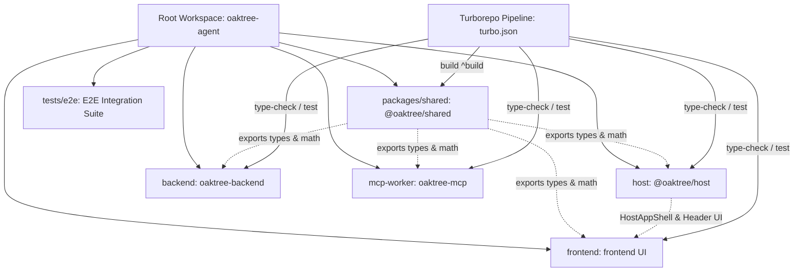

# Technical Specification: Oaktree Agent Monorepo Architecture

> **Document Version:** 1.1.0  
> **Status:** 🟢 Production Ready  
> **Target Workspaces:** `packages/shared`, `backend`, `frontend`, `host`, `mcp-worker`  
> **Orchestration:** NPM Workspaces (v11.x) + Turborepo (v2.x)  
> **Runtime / Tooling:** Node.js v22/v24, TypeScript 5.9+, Cloudflare Workers, Astro 7.x, Vite 6.x  

---

## 1. Executive Summary & Architecture Overview

### 1.1 Motivation & Migration Objectives
Prior to the monorepo migration, the `oaktree-agent` codebase operated as an isolated multi-directory repository. Each major service (`backend`, `frontend`, `mcp-worker`) maintained its own independent `package.json`, isolated `package-lock.json`, and disconnected scripts.

With ADR-0019, the architecture further evolved to decouple the **Host App Shell & Header UI** into a dedicated workspace (`host/` — `@oaktree/host`). This enables running a millisecond-fast standalone host (`npm run dev:host`) to develop and test Module Federation (`simplicity_finance`) without booting the heavy Astro frontend bundle.

### 1.2 Technology Stack
- **Package Manager:** NPM 11.6.2 (`packageManager: "npm@11.6.2"` declared in root `package.json`).
- **Lockfile Format:** Canonical lockfileVersion 3 located exclusively at repository root (`package-lock.json`).
- **Monorepo Engine:** Turborepo 2.x (`turbo ^2.11.10`) orchestrating task pipelines with topological dependency ordering and content-hashed caching.
- **Backend Infrastructure:** Cloudflare Workers running Node.js compatibility mode, Hono v4, Cloudflare D1 (SQLite), Cloudflare KV, and Workers AI.
- **Host App Shell:** Vite 6.x + React 19 + MUI Joy UI (`@oaktree/host`).
- **Frontend Infrastructure:** Astro 7.x with React 19, MUI Joy UI (`sx` styling), TanStack Router v1, and Cloudflare Pages deployment.
- **Agent / MCP Layer:** Cloudflare Worker implementing the Model Context Protocol (MCP) specification.
- **Testing Engine:** Vitest v4 across unit and E2E tiers.

### 1.3 Architecture Diagram


### 1.4 Repository Layout
```
oaktree-agent/
├── .github/
│   └── workflows/
│       ├── ci.yml                 # Monorepo CI verification across all workspaces
│       ├── deploy-backend.yml      # Cloudflare Worker backend deployment
│       ├── deploy-frontend.yml     # Cloudflare Pages frontend deployment
│       └── deploy-mcp.yml          # Cloudflare Worker MCP deployment
├── backend/                        # Cloudflare Worker API backend (Hono + D1)
│   ├── src/                       # API routes, business logic, debate engine
│   ├── migrations/                # D1 SQL migrations
│   ├── package.json               # Depends on "@oaktree/shared": "*"
│   └── wrangler.jsonc             # Backend worker configuration
├── host/                           # Standalone Vite + React SPA Host App & Shell Package
│   ├── src/                       # Header, Sidebar, Auth, Router, Federation loader
│   ├── package.json               # @oaktree/host manifest
│   ├── vite.config.ts             # Vite + Module Federation configuration
│   └── index.html                 # Host HTML shell
├── frontend/                       # Astro + React MUI Joy UI frontend (Oaktree Domain)
│   ├── src/                       # Portfolio, Market, Watchlist, Analysis, Agent
│   ├── scripts/                   # setup-wasi-fallbacks.cjs
│   └── package.json               # Depends on "@oaktree/shared" & "@oaktree/host"
├── mcp-worker/                     # Cloudflare Worker MCP server
│   ├── src/                       # Tools, resources, prompts
│   └── package.json               # Depends on "@oaktree/shared": "*"
├── packages/
│   └── shared/                    # Core TypeScript shared package (@oaktree/shared)
│       ├── src/
│       │   ├── index.ts           # Types, financial math, FIFO sorting
│       │   └── index.test.ts      # Unit tests
│       ├── package.json           # @oaktree/shared manifest
│       └── tsconfig.json          # Shared tsconfig emitting declaration files
├── docs/                          # Consolidated architecture decisions & technical specifications
├── tests/
│   └── e2e/                       # Full-stack E2E and multi-tier integration tests
├── package.json                   # Root manifest (workspaces, turbo scripts)
├── package-lock.json              # Canonical single root lockfile (lockfileVersion 3)
└── turbo.json                     # Turborepo task graph & caching configuration
```
