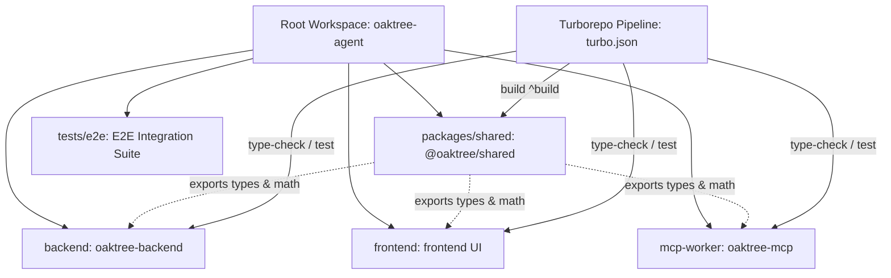

# Technical Specification: Oaktree Agent Monorepo Architecture

> **Document Version:** 1.0.0  
> **Status:** 🟢 Production Ready  
> **Target Workspaces:** `packages/shared`, `backend`, `frontend`, `mcp-worker`  
> **Orchestration:** NPM Workspaces (v11.x) + Turborepo (v2.x)  
> **Runtime / Tooling:** Node.js v22/v24, TypeScript 5.9+, Cloudflare Workers, Astro 7.x  

---

## 1. Executive Summary & Architecture Overview

### 1.1 Motivation & Migration Objectives
Prior to the monorepo migration, the `oaktree-agent` codebase operated as an isolated multi-directory repository. Each major service (`backend`, `frontend`, `mcp-worker`) maintained its own independent `package.json`, isolated `package-lock.json`, and disconnected scripts. This legacy structure introduced critical operational bottlenecks:
- **Duplicated Domain Logic & Type Drift:** Core financial models, stock statistics, DCF formulas, and portfolio calculations were duplicated across `backend/src/portfolioUtils.ts` and `frontend/src/types/`. A change to a data contract required manual, error-prone edits in multiple repositories.
- **Lockfile Fragmentation & CI Brittleness:** Three separate `package-lock.json` files led to cache misses, inconsistent dependency trees, and non-reproducible CI runs.
- **Brittle Relative Path Couplings:** Test scripts and configuration files depended on fragile relative file paths (e.g., `node ../backend/node_modules/vitest/vitest.mjs` and hardcoded aliases to `../../backend/node_modules/zod`).
- **Absence of Pipeline Caching:** Every build, test, and typecheck command ran sequentially without caching, increasing CI execution times.

The unified monorepo architecture consolidates all services into a single **NPM Workspaces** repository governed by **Turborepo 2.x**, introduces an internal core library package (`@oaktree/shared`), and modernizes all GitHub Actions workflows to use a single root lockfile.

### 1.2 Technology Stack
- **Package Manager:** NPM 11.6.2 (`packageManager: "npm@11.6.2"` declared in root `package.json`).
- **Lockfile Format:** Canonical lockfileVersion 3 located exclusively at repository root (`package-lock.json`).
- **Monorepo Engine:** Turborepo 2.x (`turbo ^2.11.10`) orchestrating task pipelines with topological dependency ordering and content-hashed caching.
- **Backend Infrastructure:** Cloudflare Workers running Node.js compatibility mode, Hono v4, Cloudflare D1 (SQLite), Cloudflare KV, and Workers AI.
- **Frontend Infrastructure:** Astro 7.x with React 19, MUI Joy UI (`sx` styling), TanStack Router v1, and Cloudflare Pages deployment.
- **Agent / MCP Layer:** Cloudflare Worker implementing the Model Context Protocol (MCP) specification.
- **Testing Engine:** Vitest v4 across unit and E2E tiers.

### 1.3 Architecture Diagram


### 1.4 Repository Layout
```
oaktree-agent/
├── .github/
│   └── workflows/
│       ├── ci.yml                 # Monorepo CI verification across all workspaces
│       ├── deploy-backend.yml      # Cloudflare Worker backend deployment
│       ├── deploy-frontend.yml     # Cloudflare Pages frontend deployment
│       └── deploy-mcp.yml          # Cloudflare Worker MCP deployment
├── backend/                        # Cloudflare Worker API backend (Hono + D1)
│   ├── src/                       # API routes, business logic, debate engine
│   ├── migrations/                # D1 SQL migrations
│   ├── package.json               # Depends on "@oaktree/shared": "*"
│   └── wrangler.jsonc             # Backend worker configuration
├── frontend/                       # Astro + React MUI Joy UI frontend
│   ├── src/                       # Pages, components, hooks, stores
│   ├── scripts/                   # setup-wasi-fallbacks.cjs
│   └── package.json               # Depends on "@oaktree/shared": "*"
├── mcp-worker/                     # Cloudflare Worker MCP server
│   ├── src/                       # Tools, resources, prompts
│   └── package.json               # Depends on "@oaktree/shared": "*"
├── packages/
│   └── shared/                    # Core TypeScript shared package (@oaktree/shared)
│       ├── src/
│       │   ├── index.ts           # Types, financial math, FIFO sorting
│       │   └── index.test.ts      # Unit tests
│       ├── package.json           # @oaktree/shared manifest
│       └── tsconfig.json          # Shared tsconfig emitting declaration files
├── docs/                          # Consolidated architecture decisions & technical specifications
│   ├── CONTEXT.md                 # Domain context & glossary
│   ├── adr/                       # Architecture Decision Records (0001 - 0011)
│   └── specs/                     # Architecture, model, and system specifications
│       ├── MONOREPO_SPEC.md       # This specification
│       ├── DCF_MODEL_SPEC.md      # Interactive DCF Model specification
│       └── ...
├── tests/
│   └── e2e/                       # Full-stack E2E and multi-tier integration tests
│       ├── vitest.config.ts       # Hoisting-resilient Vitest configuration
│       └── *.test.ts              # Tier 1-4 tests
├── package.json                   # Root manifest (workspaces, turbo scripts)
├── package-lock.json              # Canonical single root lockfile (lockfileVersion 3)
└── turbo.json                     # Turborepo task graph & caching configuration
```

---

## 2. Workspace Package Structure

The repository organizes business applications and shared modules into four distinct workspaces defined in the root manifest `workspaces` array (`backend`, `frontend`, `mcp-worker`, and `packages/*`):

| Package Identifier | Directory | Framework / Runtime | Purpose | Shared Dependency |
|---|---|---|---|---|
| `@oaktree/shared` | `packages/shared` | TypeScript (Pure ESM) | Core domain types, financial math, portfolio FIFO matching | Publisher (`src/index.ts`) |
| `oaktree-backend` | `backend` | Cloudflare Workers / Hono | REST API, AI debate engine, D1 database migrations, financial feeds | `@oaktree/shared: "*"` |
| `frontend` | `frontend` | Astro 7.x / React 19 / MUI Joy | Market intelligence dashboard, DCF valuation modeling, chart visualizations | `@oaktree/shared: "*"` |
| `oaktree-mcp` | `mcp-worker` | Cloudflare Workers / MCP SDK | Model Context Protocol tools, resources, and agent execution bridges | `@oaktree/shared: "*"` |

> **Note on `tests/e2e`:** `tests/e2e` is an integration and contract test suite directory executed from the repository root via `npm run test:e2e` (`vitest run --config tests/e2e/vitest.config.ts`). It is not an NPM workspace and does not contain a separate `package.json`.

### 2.1 Package Manifests & Linkage
Workspace packages reference `@oaktree/shared` via the wildcard workspace protocol:
```json
{
  "dependencies": {
    "@oaktree/shared": "*"
  }
}
```
During `npm install`, NPM Workspaces creates symbolic links in the root `node_modules/@oaktree/shared` pointing directly to `packages/shared`. This guarantees immediate, zero-latency feedback during local development without requiring publication to an external package registry.

---

## 3. Turborepo Task Pipeline & Caching

### 3.1 Task Graph Configuration (`turbo.json`)
Task execution and caching policies are defined in `turbo.json`:
```json
{
  "$schema": "https://turbo.build/schema.json",
  "tasks": {
    "build": {
      "dependsOn": ["^build"],
      "outputs": ["dist/**", ".astro/**"]
    },
    "type-check": {
      "dependsOn": ["^build"],
      "outputs": []
    },
    "test": {
      "dependsOn": ["^build"],
      "outputs": []
    },
    "cf-typegen": {
      "outputs": ["worker-configuration.d.ts"]
    },
    "dev": {
      "cache": false,
      "persistent": true
    }
  }
}
```

### 3.2 Task Definitions & Dependencies
1. **`build`:**
   - Employs topological dependency ordering (`dependsOn: ["^build"]`).
   - When building `frontend` or `backend`, Turborepo first verifies that `@oaktree/shared` has been built and its `dist/` artifacts are up to date.
   - Cache outputs: `packages/shared/dist/**`, `frontend/dist/**`, and `.astro/**`.
2. **`type-check`:**
   - Runs `tsc --noEmit` across all workspaces.
   - Depends on `^build` so that ambient declaration types (`dist/index.d.ts`) of upstream packages are fully generated before downstream consumers run type checking.
3. **`test`:**
   - Runs unit test suites (`vitest run`) in parallel across workspaces.
   - Also depends on `^build` to ensure code changes in `@oaktree/shared` are compiled before dependent unit tests run.
4. **`cf-typegen`:**
   - Generates TypeScript interfaces from Cloudflare bindings (`wrangler types`) into `worker-configuration.d.ts` for `backend` and `mcp-worker`.
5. **`dev`:**
   - Interactive local development task with caching disabled (`cache: false`) and long-running process persistence enabled (`persistent: true`).

### 3.3 High-Performance Caching & FULL TURBO
Turborepo calculates a cryptographic hash for every task execution based on:
- Source file contents in the package directory.
- Relevant environment variables.
- Direct upstream dependency hashes.

When inputs are unchanged, Turborepo replays terminal logs and restores build outputs in **under 300ms** (`FULL TURBO`). 

#### Local Cache Hygiene:
- Turborepo caches metadata and artifacts under `.turbo/`.
- The `.turbo/` folder is explicitly excluded from version control in `.gitignore`.
- Cache can be manually invalidated at any time using the `--force` flag:
  ```bash
  npx turbo run build type-check --force
  ```

---

## 4. `@oaktree/shared` Standards & API

### 4.1 Package Architecture & Artifact Contracts
The shared library is located at `packages/shared`. Its manifest defines both runtime module exports and TypeScript type declaration paths:
```json
{
  "name": "@oaktree/shared",
  "version": "1.0.0",
  "type": "module",
  "main": "dist/index.js",
  "types": "dist/index.d.ts",
  "exports": {
    ".": {
      "types": "./dist/index.d.ts",
      "import": "./dist/index.js"
    }
  },
  "scripts": {
    "build": "tsc",
    "type-check": "tsc --noEmit",
    "test": "vitest run"
  }
}
```

### 4.2 TypeScript Configuration (`tsconfig.json`)
`packages/shared/tsconfig.json` specifies:
```json
{
  "compilerOptions": {
    "target": "ES2022",
    "module": "ESNext",
    "moduleResolution": "bundler",
    "declaration": true,
    "declarationMap": true,
    "outDir": "./dist",
    "rootDir": "./src",
    "strict": true,
    "skipLibCheck": true
  },
  "include": ["src/**/*"],
  "exclude": ["dist", "src/**/*.test.ts"]
}
```
This configuration outputs both JavaScript ES modules and `.d.ts` declaration maps to `dist/`, providing strong ambient type safety across the monorepo.

### 4.3 Public API Surface
`@oaktree/shared` exports pure domain models, data types, and deterministic financial calculations:

#### 1. Core Domain Models & Schemas
- **`CompanyStats`:** 38 standardized financial fundamental fields including market capitalization, P/E, forward P/E, PEG ratio, EV/EBITDA, gross margin, operating margin, ROE, FCF conversion, and valuation multiples.
- **`AnalysisCoverage` & `AnalysisCoverageMap`:** Tracking flags for automated thesis generation, DCF modeling, sentiment analysis, and risk arbitration.
- **`DcfScenarioInput`:** Standardized input model for Discounted Cash Flow valuations (revenue growth, gross margin improvement, OPEX margin, tax rate, WACC, and terminal growth rate).
- **`DCF_SCENARIO_NAMES`:** Immutable tuple `['Base Case', 'Bull Case', 'Bear Case'] as const`.
- **`GuidanceInfo` & `StockFundamental`:** Normalized reporting structures for quarterly company disclosures and market statistics.
- **`PortfolioTransaction` & `PortfolioLot`:** Transaction structures for portfolio tracking and performance attribution.

#### 2. Pure Financial Math & Utilities
- **`calculateCAGR(startValue: number, endValue: number, years: number): number`:**  
  Computes the Compound Annual Growth Rate: $(endValue / startValue)^{1 / years} - 1$. Returns decimal growth rate (e.g. `0.10` for 10%, not multiplied by 100). Handles non-positive start values or zero/negative years safely by returning 0.
- **`calculateDiscountFactor(rate: number, year: number): number`:**  
  Calculates present value discount factor: $1 / (1 + rate)^{year}$. Takes decimal discount rate (e.g. `0.10` for 10%, not divided by 100). Returns 1 for year 0, and 0 for negative years or invalid rates.
- **`roundTo(value: number, decimals: number): number`:**  
  Deterministic floating-point rounding avoiding precision artifacts.
- **`formatCurrency(value: number, currency = '$'): string`:**  
  Formats values into comma-separated currency representations with 2 decimal places (e.g. `"$1,234.56"` or `"-$1,234.56"`). Supports custom currency symbols (e.g. `'฿'`, `'THB'`, `'EUR'`). Returns `'--'` for null, undefined, or NaN.
- **`formatPercent(value: number, decimals = 2): string`:**  
  Formats percentages with configurable precision and sign handling.

#### 3. Portfolio FIFO Lot Matching
- **`sortTransactions(transactions: any[]): any[]`:**  
  Pure function that sorts portfolio transactions in First-In-First-Out (FIFO) chronological order. When transaction timestamps are identical, `'BUY'` operations take deterministic precedence over `'SELL'` operations to prevent invalid negative holding calculations.

#### 4. Backend Re-export Bridge
To preserve backwards compatibility for existing imports in `backend`, `backend/src/portfolioUtils.ts` acts as a re-export bridge:
```typescript
export { sortTransactions } from '@oaktree/shared';
```

---

## 5. Hoisting & Dependency Management

### 5.1 Single Root Lockfile Strategy
NPM Workspaces operates with a unified root `package-lock.json` (lockfileVersion 3). Sub-directory lockfiles (`backend/package-lock.json`, `frontend/package-lock.json`, `mcp-worker/package-lock.json`) are permanently deleted.
- **Hoisting Mechanics:** All third-party dependencies are hoisted to the root `node_modules` directory unless there are conflicting version requirements.
- **Workspace Symlinking:** Each workspace package is symlinked into root `node_modules/@oaktree/shared`, allowing Node module resolution to seamlessly traverse from any package directory up to the root.

### 5.2 Tooling Version Alignment
To prevent version fragmentation across Cloudflare Worker packages, key dependencies are aligned across `backend` and `mcp-worker`:
- `@cloudflare/workers-types`: `^5.20261003.1`
- `wrangler`: `^4.147.0`
- `vitest`: `^4.1.11` (unified across root and all workspaces)

### 5.3 Hoisting Compatibility Fixes
Monorepo hoisting changes the physical location of `node_modules`. Three specific compatibility layers ensure smooth operation:

1. **WASI Fallback Dynamic Resolution (`frontend/scripts/setup-wasi-fallbacks.cjs`):**  
   The Astro compilation toolchain on Windows requires WASI native fallback bindings for `satteri` and `@astrojs/compiler-binding`. The fallback script searches both `[frontendRoot, monorepoRoot]` directories:
   ```javascript
   function findModuleRoot(pkgName, startDir) {
     try {
       const resolved = require.resolve(`${pkgName}/package.json`, { paths: [startDir, root] });
       return path.dirname(resolved);
     } catch (e) {
       // Fall back to direct directory existence checks
       const localPath = path.join(startDir, 'node_modules', pkgName);
       if (fs.existsSync(localPath)) return localPath;
       const rootPath = path.join(root, 'node_modules', pkgName);
       if (fs.existsSync(rootPath)) return rootPath;
       return null;
     }
   }
   ```
2. **Direct CLI Invocation for MCP Worker (`mcp-worker/package.json`):**  
   Legacy relative paths referencing `node ../backend/node_modules/vitest/vitest.mjs` were eliminated in favor of direct CLI binary invocation:
   ```json
   {
     "scripts": {
       "test": "vitest run"
     }
   }
   ```
3. **E2E Test Runner Vitest Modernization (`tests/e2e/vitest.config.ts`):**  
   Hardcoded references to `../../backend/node_modules` were removed. Vitest cache directories and module aliases resolve via standard Node.js module resolution from root `node_modules`.

---

## 6. CI/CD Integration & Workflow Automation

GitHub Actions workflows located in `.github/workflows/` are fully integrated with the monorepo structure.

### 6.1 Workflow Invariants
Every workflow follows these mandatory patterns:
1. **Repository-Level Checkout:** Always check out the full repository root (`actions/checkout@v4`).
2. **Unified Lockfile Caching:** Use `actions/setup-node@v4` with `cache: 'npm'` and `cache-dependency-path: package-lock.json`.
3. **Root Dependency Installation:** Run `npm ci` strictly from the repository root (no `--prefix` or `working-directory` on install steps).
4. **Workspace Scoped Commands:** Scoped commands (`wrangler deploy`, `npm run build`, `npm test`) execute with their appropriate `working-directory` or Turborepo filter.

### 6.2 CI Pipeline (`.github/workflows/ci.yml`)
Runs on pushes and pull requests targeting `main` and `develop`.
- **`build-backend`:** Executes root `npm ci`, runs `tsc --noEmit`, executes 23 backend test suites via `npm test`, and validates configuration with `wrangler deploy --dry-run`.
- **`build-frontend`:** Executes root `npm ci`, runs `astro check`, runs 13 frontend test suites via `npm test`, and executes production Astro build (`npm run build`).
- **`build-mcp`:** Executes root `npm ci`, runs `tsc --noEmit`, executes MCP test suites, and verifies deployment readiness with `wrangler deploy --dry-run`.

### 6.3 Deployment Pipelines (`deploy-*.yml`)
Continuous deployment workflows deploy services to Cloudflare upon pushes to `main`. To prevent stale deployments when shared code changes, all deployment workflows monitor `packages/shared/**`:

```yaml
on:
  push:
    branches:
      - main
    paths:
      - '<service-dir>/**'
      - 'packages/shared/**'
      - 'package.json'
      - 'package-lock.json'
      - '.github/workflows/<workflow-name>.yml'
  workflow_dispatch:
```

- **`deploy-backend.yml`:** Applies Cloudflare D1 database migrations (`d1 migrations apply moltbot-db --remote`) and deploys the backend Worker.
- **`deploy-frontend.yml`:** Builds the Astro frontend application and deploys the `frontend/dist` directory to Cloudflare Pages (`oaktree-agent-frontend`).
- **`deploy-mcp.yml`:** Deploys the Model Context Protocol Worker (`oaktree-mcp`) to Cloudflare Workers.

---

## 7. Developer Workflows & Troubleshooting

### 7.1 Quick Start
Clone the repository and install all dependencies:
```bash
git clone https://github.com/your-org/oaktree-agent.git
cd oaktree-agent

# Install dependencies and link all workspaces
npm install
```

### 7.2 Common CLI Commands
Execute tasks across workspaces from the repository root:

| Command | Action | Pipeline Details |
|---|---|---|
| `npm run dev` | Start development servers | Starts `backend` and `frontend` dev processes concurrently |
| `npm run build` | Build all packages | Topological order: builds `@oaktree/shared` then apps |
| `npm test` | Run all unit tests | Executes tests across `packages/shared`, `backend`, `frontend`, `mcp-worker` |
| `npm run ci:typecheck` | Full type check | Executes `tsc --noEmit` across all workspaces via Turborepo |
| `npm run test:e2e` | Run E2E test suite | Executes full-stack integration tests via root Vitest |
| `npm run cf-typegen` | Generate CF types | Extracts D1/KV bindings to `worker-configuration.d.ts` |

### 7.3 Managing Dependencies
- **Add a dependency to a specific workspace:**
  ```bash
  npm install <package-name> --workspace=<workspace-name>
  # Example: npm install lodash-es --workspace=@oaktree/shared
  # Example: npm install zod --workspace=oaktree-backend
  ```
- **Add a root development tool:**
  ```bash
  npm install <package-name> --save-dev
  # Example: npm install -D eslint
  ```
- **Adding a new workspace package:**
  1. Create folder `packages/<new-package>`.
  2. Run `npm init -y` inside `packages/<new-package>`.
  3. Ensure `name` in `package.json` follows `@oaktree/<name>`.
  4. Run `npm install` at root to regenerate symlinks.

### 7.4 Troubleshooting & FAQ

#### 1. Turborepo cache is returning stale results
Force a fresh execution without reading or writing cache:
```bash
npx turbo run build type-check test --force
```
Or delete local cache directories:
```bash
rm -rf .turbo
```

#### 2. TypeScript cannot resolve `@oaktree/shared`
Ensure `@oaktree/shared` has been compiled so `dist/index.d.ts` exists:
```bash
npm run build --workspace=@oaktree/shared
```

#### 3. Corrupted or mismatched `node_modules`
Perform a clean reinstall across all workspaces:
```bash
# Windows PowerShell
Remove-Item -Recurse -Force node_modules, backend/node_modules, frontend/node_modules, mcp-worker/node_modules, packages/shared/node_modules
npm install
```

#### 4. Pre-push Release Validation
In accordance with repository release management policies (`release/SKILL.md`), all code must pass typecheck before merging or pushing to `develop` or `main`:
```bash
npm run ci:typecheck && npm test
```
