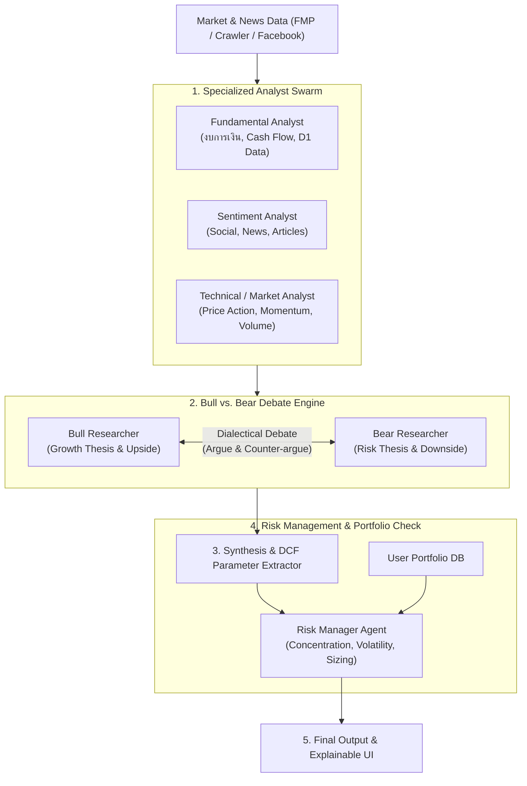

# 📋 Oaktree Multi-Agent Feature Roadmap & TODO List
*(Inspired by TauricResearch/TradingAgents Architecture)*

เอกสารบันทึกแผนงานและ TODO List สำหรับการนำแนวคิด Multi-Agent Architecture (Specialized Analysts, Bull vs. Bear Debate, Risk Management, และ Explainable Decision Trace) มาปรับใช้เพื่อยกระดับ Oaktree Agent

---

## 🎯 ภาพรวมสถาปัตยกรรมเป้าหมาย (Target Architecture)

---

## 📝 TODO List ตามลำดับ Phase

### 🚀 Phase 1: Quick Wins — Bull vs. Bear Analysis & Summary (Completed ✅)
> **เป้าหมาย:** เพิ่มมิติการวิเคราะห์หุ้นแบบ 2 ขั้วตรงข้าม (Adversarial View) ในหน้า Stock Analysis ทันที เพื่อลด Confirmation Bias

- [x] **Backend: Prompts & Engine (`backend/src/analysisPrompts.ts`, `backend/src/analysisEngine.ts`)**
  - [x] ออกแบบ Prompt แยก 2 บทบาท: `BULL_THESIS_PROMPT` (Upside catalysts, moat, growth) และ `BEAR_THESIS_PROMPT` (Risks, accounting red flags, valuation stretch)
  - [x] ทำฟังก์ชันรันการวิเคราะห์คู่ขนาน (Parallel LLM generation via Workers AI / Gemini)
  - [x] สร้าง Output schema รองรับ `{ bullPoints: string[], bearPoints: string[], keyDebateSummary: string }`
- [x] **API Endpoint (`backend/src/routes/`)**
  - [x] เพิ่ม Endpoint `POST /api/stocks/:symbol/debate-summary` หรือรวมเข้ากับ Endpoint วิเคราะห์หุ้นเดิม
- [x] **Frontend UI (`frontend/src/`)**
  - [x] ออกแบบการ์ดแสดงผลคู่ขนานแบบ Side-by-Side (MUI Joy UI `Grid` หรือ `Card`)
  - [x] ฝั่งซ้าย: สีเขียว/Neutral (Bull Case Catalysts)
  - [x] ฝั่งขวา: สีแดง/Warning (Bear Case Risks)
  - [x] สรุป Key Tension / จุดชี้ขาดสำคัญของหุ้นตัวนั้น

---

### 🧮 Phase 2: AI-Assisted DCF Valuation Scenarios (Completed ✅)
> **เป้าหมาย:** เชื่อมโยงผลวิเคราะห์ Multi-Agent เข้ากับโมเดล DCF ที่มีอยู่เดิมใน Oaktree เพื่อตั้งค่า Base, Bear, Bull Case อัตโนมัติ พร้อมประเมิน Margin of Safety

- [x] **DCF Parameter Recommendation Agent (via Gemini App & MCP)**
  - [x] ให้ Agent วิเคราะห์ Historical Financials + ผล Bull/Bear เพื่อประเมินช่วงตัวเลขสมมติฐาน:
    - Revenue Growth Rate (Yr 1-5)
    - Operating Margin
    - WACC / Discount Rate
    - Terminal Growth Rate
  - [x] แมปผลลัพธ์เป็น 3 Presets: `Bull Case`, `Base Case`, `Bear Case`
- [x] **Integration กับ DCF Engine & Margin of Safety Workflow (`packages/shared/src/marginOfSafety.ts`, `frontend/src/components/common/ScenarioRangeBar.tsx`)**
  - [x] ใช้ Gemini app วิเคราะห์ Bull/Bear/Base scenarios และใช้ `mcp-worker` บันทึกพารามิเตอร์ DCF ลง D1
  - [x] **Scenario Range & Margin of Safety Bar (ในหน้า DCF / Stock Detail):** แสดงแถบเปรียบเทียบ Current Market Price เทียบกับกรอบ `[Bear — Base — Bull]` พร้อมคำนวณ MoS %, Upside/Downside %, และ Asymmetric Risk/Reward Ratio
  - [x] **Watchlist / Portfolio MoS Screener (`MyWatchlist.tsx`, `HoldingsTab.tsx`, `HoldingsTable.tsx`):** เพิ่มการแสดงผล กรอง และจัดเรียงหุ้นตาม DCF Base MoS % และสถานะ Margin of Safety

---

### 👥 Phase 3: Specialized Analyst Swarm (Workers AI / Agents SDK)
> **เป้าหมาย:** แยกย่อยการวิเคราะห์เป็น Agent เฉพาะทางเพื่อเพิ่มความลึกและแม่นยำของข้อมูล

- [ ] **Fundamental Analyst Agent**
  - [ ] เจาะลึกงบดุล, กระแสเงินสดอิสระ (FCF), หนี้สิน, และแนวโน้มความสามารถในการทำกำไร (ROIC/ROE)
- [ ] **Sentiment & News Analyst Agent**
  - [ ] เชื่อมต่อข้อมูลจาก Crawler ข่าว, Facebook posts, และ Articles ในระบบ
  - [ ] ให้คะแนน Market Sentiment Score (-10 ถึง +10) พร้อมประเด็นร้อน
- [ ] **Technical & Momentum Analyst Agent**
  - [ ] คำนวณระดับราคาแนวรับ-แนวต้าน, Moving Averages, RSI/MACD divergence
- [ ] **Orchestration Layer**
  - [ ] พัฒนา Workflow / Pipeline รวบรวมรายงานจากทุก Analyst ก่อนส่งต่อเข้า Debate Engine

---

### 🛡️ Phase 4: Risk Officer & Portfolio Health Advisory (Completed ✅)
> **เป้าหมาย:** ระบบตรวจสอบความเสี่ยงพอร์ตและให้คำแนะนำในการจัดขนาดสถานะการลงทุน (Position Sizing)

- [x] **Portfolio Risk Audit Engine (`packages/shared/src/portfolioRisk.ts`, `backend/src/portfolioRisk.ts`)**
  - [x] ตรวจจับ Concentration Risk (8% Target Weight, 15% Single-Stock Cap, 30% Strictest Theme Cap, HHI & Effective Positions)
  - [x] ตรวจจับ Correlation Risk & Market Sensitivity (252-day Pearson correlation pairs `r >= 0.70` และ Portfolio Beta vs `^GSPC`)
  - [x] คำนวณ Portfolio Health Score (0-100) พร้อมรายละเอียดการหักคะแนนตามระดับความเสี่ยง
- [x] **Risk Advisor Component & MCP Integration (`frontend/src/components/features/portfolio/RiskSizingTab.tsx`, `ThemeDonutChart.tsx`, `mcp-worker/src/riskTools.ts`)**
  - [x] แสดงแดชบอร์ด KPI, ตาราง Concentration & Sizing Capacity, และ Interactive Theme Donut Chart (120 FPS micro-interactions)
  - [x] Position Sizing & Pre-Trade Simulator คำนวณ Room to Target (8%), Stock Cap (15%), Strictest Theme Cap (30%) และจำลองผลกระทบก่อนเทรด
  - [x] ระบบ AI Risk Officer Advisory (Howard Marks Framework) รองรับทั้ง Cloudflare Workers AI และ Gemini App ผ่าน MCP (`get_portfolio_risk_audit`, `calculate_position_size`, `save_risk_advisory`)
  - [-] ~~Conviction & MoS-Weighted Dynamic Sizing~~ *(Skipped — ใช้ Fixed Governance Caps 8% / 15% / 30% เป็นเกณฑ์มาตรฐาน และให้ผู้ลงทุนพิจารณา Conviction แบบ Manual ด้วยตัวเอง)*
- [x] **Technical Polish & Instant UX (ADR-0015)**
  - [x] **Instant 0ms Client-Side Position Sizing Simulator (`RiskSizingTab.tsx`):** คำนวณ `calculateFixedBasePositionSize` และ `simulatePreTradeImpact` จาก `@oaktree/shared` บนฝั่ง Client แบบ `0ms` ทันทีที่เปลี่ยนค่า พร้อมปุ่ม `Reset` และแนบ `themeMappings` ใน `GET /api/portfolio/risk-audit` เพื่อรองรับหุ้นใหม่ที่ผูก Theme ไว้แต่ยังไม่อยู่ในพอร์ต
  - [x] **Deduplicate `@oaktree/shared` Risk Engine:** เปลี่ยน `backend/src/portfolioRisk.ts` ให้ Re-export จาก `@oaktree/shared` เป็น Single Source of Truth เดียวกันทั้ง `backend`, `mcp-worker`, และ `frontend`
  - [x] **Parallelize D1 Risk Audit Queries (`backend/src/routes/portfolio/risk.ts`, `mcp-worker/src/riskTools.ts`):** รัน 5 คำสั่ง D1 ที่เป็นอิสระต่อกันแบบขนานด้วย `Promise.all` ลด Latency ของ Risk Audit ลงเหลือ 2 sequential stages

---

### 📜 Phase 5: Unified "Investment Dossier & Decision Trace" UI (One-Page Stock Cockpit) (Completed ✅)
> **เป้าหมาย:** รวมศูนย์การวิเคราะห์และตรวจสอบตรรกะการตัดสินใจของ AI ทุกมิติ (Valuation, Adversarial Debate, Portfolio Governance, Thesis) ไว้ในหน้าเดียว (One-Page Stock Cockpit) ตามสถาปัตยกรรม [ADR-0016](file:///c:/Users/natta/Documents/antigravity/oaktree-agent/docs/adr/0016-unified-stock-dossier-cockpit-and-decision-trace.md)

- [x] **1. Navigation & Master Layout (`frontend/src/components/features/agent/`)**
  - [x] เพิ่ม Tab แรก "Cockpit / Dossier" (Tab 0) ใน [AnalysisReport.tsx](file:///c:/Users/natta/Documents/antigravity/oaktree-agent/frontend/src/components/features/agent/AnalysisReport.tsx) โดยยังคง Tab เดิม (`Overview`, `Report`, `DCF Model`, `Stock Thesis`) ไว้เป็น Deep-Dive Tools
  - [x] สร้าง Component หลัก [StockDossierCockpit.tsx](file:///c:/Users/natta/Documents/antigravity/oaktree-agent/frontend/src/components/features/agent/StockDossierCockpit.tsx)
  - [x] จัดทำ Toggle สลับมุมมอง: "Executive Cockpit" (Summary Mode) vs "Decision Trace Flow" (Audit Timeline Mode)

- [x] **2. Cockpit Hero & Actionability Banner**
  - [x] แสดงสัญลักษณ์หุ้น, ชื่อบริษัท, ราคาปัจจุบัน, P/E, P/FCF, Theme/Sector Tag
  - [x] ฝัง [ScenarioRangeBar.tsx](file:///c:/Users/natta/Documents/antigravity/oaktree-agent/frontend/src/components/common/ScenarioRangeBar.tsx) แสดงกรอบ `[Bear — Base — Bull]` และ MoS %
  - [x] แสดง Position Sizing Capacity Badge (Room to 8% target, 15% single cap, 30% theme cap) จาก `@oaktree/shared`
  - [x] Quick Action Buttons: ไปยัง DCF Model, แก้ไข Thesis, หรือกด Quick Pre-Trade Simulator

- [x] **3. 4-Quadrant High-Density Intelligence Grid**
  - [x] **Quadrant A (Valuation Anchor):** สรุปผล DCF Intrinsic Value ทั้ง 3 Scenarios, Margin of Safety %, WACC, และ Terminal Growth
  - [x] **Quadrant B (Adversarial Debate):** สรุป Bull Catalysts vs Bear Downside Risks, Key Tensions, และ Conviction Score จาก Dialectical Debate
  - [x] **Quadrant C (Portfolio Governance & Sizing):** ผลกระทบต่อ Portfolio Health Score, Correlation risk กับหุ้นอื่นในพอร์ต, และขนาดการซื้อที่ปลอดภัย
  - [x] **Quadrant D (Investor Thesis & Catalysts):** สรุปสมมติฐานการลงทุนของผู้ใช้, Target Price, วันทบทวนถัดไป, และบันทึก Journal ล่าสุด

- [x] **4. Hybrid Real-Time Decision Trace Flow (Auditability Timeline)**
  - [x] สังเคราะห์ Timeline อัตโนมัติจากข้อมูลใน D1 โดยไม่ต้องสร้างตารางใหม่:
    1. *Stage 1: Data Ingestion & Freshness* (รอบงบการเงิน D1 + ข่าวล่าสุด)
    2. *Stage 2: Adversarial Debate Synthesis* (จุดขัดแย้งสำคัญและคะแนน Conviction)
    3. *Stage 3: DCF Valuation Modeling* (การแปลงข้อถกเถียงเป็นพารามิเตอร์ DCF และ MoS %)
    4. *Stage 4: Portfolio Risk Audit* (การตรวจสอบเกณฑ์ 8%/15%/30% และ Portfolio Beta)
    5. *Stage 5: Final Execution Advisory* (คำแนะนำสถานะการลงทุน)

- [x] **5. Client-Side Orchestration (`Promise.all`)**
  - [x] ดึงข้อมูลพร้อมกัน 4 Endpoint ในฝั่ง Client: `/overview`, `/analysis/results`, `/analysis/theses`, และ `/portfolio/risk-audit`
  - [x] ใช้ Pure functions จาก `@oaktree/shared` คำนวณ Sizing Room และ MoS แบบ Instant 0ms
  - [x] เขียนชุดการทดสอบครอบคลุมทุกมุมมองใน [StockDossierCockpit.test.tsx](file:///c:/Users/natta/Documents/antigravity/oaktree-agent/frontend/src/components/features/agent/StockDossierCockpit.test.tsx)

---

## 📌 Technical Considerations & Stack Compatibility

1. **Serverless & Edge Limitations (Cloudflare Workers):**
   - การรัน Multi-turn debate ยาวๆ อาจติด Time limit ของ Edge Worker ปกติ
   - *แนวทางแก้ไข:* ใช้ **Cloudflare Workflows** หรือ **Agents SDK** ในการจัดการ Background asynchronous execution และบันทึก State ลง D1 Database
2. **Token Economy & Latency:**
   - ใช้โมเดลขนาดเล็ก (เช่น Workers AI / Gemini Flash) สำหรับขั้นตอนรวบรวมข้อมูลและ Debate เบื้องต้น
   - ใช้โมเดลใหญ่ขึ้นเฉพาะขั้นตอน Final Synthesis
3. **UI Standard (Oaktree Front-end):**
   - ใช้ MUI Joy UI + `sx` props ตามข้อกำหนดอย่างเคร่งครัด
   - นำ Glassmorphism & Card patterns ที่มีอยู่มาจัดวาง Layout สำหรับ Debate และ Decision Trace
