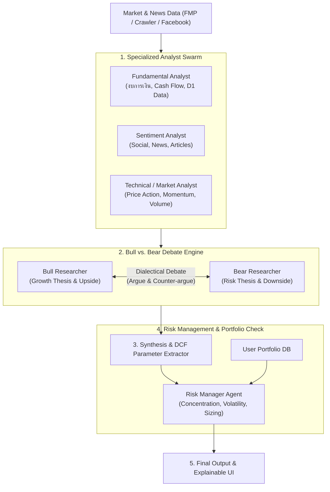

# 📋 Oaktree Multi-Agent Feature Roadmap & TODO List
*(Inspired by TauricResearch/TradingAgents Architecture)*

เอกสารบันทึกแผนงานและ TODO List สำหรับการนำแนวคิด Multi-Agent Architecture (Specialized Analysts, Bull vs. Bear Debate, Risk Management, และ Explainable Decision Trace) มาปรับใช้เพื่อยกระดับ Oaktree Agent

---

## 🎯 ภาพรวมสถาปัตยกรรมเป้าหมาย (Target Architecture)

---

## 📝 TODO List ตามลำดับ Phase

### 🚀 Phase 1: Quick Wins — Bull vs. Bear Analysis & Summary
> **เป้าหมาย:** เพิ่มมิติการวิเคราะห์หุ้นแบบ 2 ขั้วตรงข้าม (Adversarial View) ในหน้า Stock Analysis ทันที เพื่อลด Confirmation Bias

- [ ] **Backend: Prompts & Engine (`backend/src/analysisPrompts.ts`, `backend/src/analysisEngine.ts`)**
  - [ ] ออกแบบ Prompt แยก 2 บทบาท: `BULL_THESIS_PROMPT` (Upside catalysts, moat, growth) และ `BEAR_THESIS_PROMPT` (Risks, accounting red flags, valuation stretch)
  - [ ] ทำฟังก์ชันรันการวิเคราะห์คู่ขนาน (Parallel LLM generation via Workers AI / Gemini)
  - [ ] สร้าง Output schema รองรับ `{ bullPoints: string[], bearPoints: string[], keyDebateSummary: string }`
- [ ] **API Endpoint (`backend/src/routes/`)**
  - [ ] เพิ่ม Endpoint `POST /api/stocks/:symbol/debate-summary` หรือรวมเข้ากับ Endpoint วิเคราะห์หุ้นเดิม
- [ ] **Frontend UI (`frontend/src/`)**
  - [ ] ออกแบบการ์ดแสดงผลคู่ขนานแบบ Side-by-Side (MUI Joy UI `Grid` หรือ `Card`)
  - [ ] ฝั่งซ้าย: สีเขียว/Neutral (Bull Case Catalysts)
  - [ ] ฝั่งขวา: สีแดง/Warning (Bear Case Risks)
  - [ ] สรุป Key Tension / จุดชี้ขาดสำคัญของหุ้นตัวนั้น

---

### 🧮 Phase 2: AI-Assisted DCF Valuation Scenarios
> **เป้าหมาย:** เชื่อมโยงผลวิเคราะห์ Multi-Agent เข้ากับโมเดล DCF ที่มีอยู่เดิมใน Oaktree เพื่อตั้งค่า Base, Bear, Bull Case อัตโนมัติ

- [ ] **DCF Parameter Recommendation Agent**
  - [ ] ให้ Agent วิเคราะห์ Historical Financials + ผล Bull/Bear เพื่อประเมินช่วงตัวเลขสมมติฐาน:
    - Revenue Growth Rate (Yr 1-5)
    - Operating Margin
    - WACC / Discount Rate
    - Terminal Growth Rate
  - [ ] แมปผลลัพธ์เป็น 3 Presets: `Bull Case`, `Base Case`, `Bear Case`
- [ ] **Integration กับ DCF Engine (`backend/src/dcfAnalysis.ts`, `frontend/src/components/DCF/`)**
  - [ ] เพิ่มปุ่ม *"Auto-fill with AI Multi-Scenario"* ในหน้า DCF Valuation Model
  - [ ] มีช่องแสดงเหตุผลสนับสนุน (Rationale) กำกับในแต่ละสมมติฐานตัวเลข
  - [ ] คำนวณ Margin of Safety เปรียบเทียบกับราคาตลาดปัจจุบันแบบไดนามิก

---

### 👥 Phase 3: Specialized Analyst Swarm (Workers AI / Agents SDK)
> **เป้าหมาย:** แยกย่อยการวิเคราะห์เป็น Agent เฉพาะทางเพื่อเพิ่มความลึกและแม่นยำของข้อมูล

- [ ] **Fundamental Analyst Agent**
  - [ ] เจาะลึกงบดุล, กระแสเงินสดอิสระ (FCF), หนี้สิน, และแนวโน้มความสามารถในการทำกำไร (ROIC/ROE)
- [ ] **Sentiment & News Analyst Agent**
  - [ ] เชื่อมต่อข้อมูลจาก Crawler ข่าว, Facebook posts, และ Articles ในระบบ
  - [ ] ให้คะแนน Market Sentiment Score (-10 ถึง +10) พร้อมประเด็นร้อน
- [ ] **Technical & Momentum Analyst Agent**
  - [ ] คำนวณระดับราคาแนวรับ-แนวต้าน, Moving Averages, RSI/MACD divergence
- [ ] **Orchestration Layer**
  - [ ] พัฒนา Workflow / Pipeline รวบรวมรายงานจากทุก Analyst ก่อนส่งต่อเข้า Debate Engine

---

### 🛡️ Phase 4: Risk Officer & Portfolio Health Advisory
> **เป้าหมาย:** ระบบตรวจสอบความเสี่ยงพอร์ตและให้คำแนะนำในการจัดขนาดสถานะการลงทุน (Position Sizing)

- [ ] **Portfolio Risk Audit Engine (`backend/src/portfolioUtils.ts`)**
  - [ ] ตรวจจับ Concentration Risk (มีหุ้นรายตัว หรือกลุ่มอุตสาหกรรมใดเกินเกณฑ์ % พอร์ต)
  - [ ] ตรวจจับ Correlation Risk (หุ้นในพอร์ตเคลื่อนไหวไปในทิศทางเดียวกันมากเกินไป)
- [ ] **Risk Advisor Component**
  - [ ] แสดงข้อแนะนำเมื่อผู้ใช้เปิดดูพอร์ต เช่น *"Warning: Tech Sector สัดส่วนแตะ 42% เกินระดับปลอดภัยที่ 30%"*
  - [ ] ให้คำแนะนำ Position Sizing ที่เหมาะสมก่อนเข้าซื้อตามหลัก Kelly Criterion หรือ Fixed Risk %

---

### 📜 Phase 5: Decision Trace & Auditability UI
> **เป้าหมาย:** ทำให้นักลงทุนสามารถตรวจสอบตรรกะและที่มาของการตัดสินใจของ AI ได้อย่างโปร่งใส

- [ ] **Timeline / Reasoning Flow UI (`frontend/src/`)**
  - [ ] สร้าง Accordion หรือ Timeline Component แสดงลำดับการประมวลผล:
    1. *Data Gathered* (งบการเงิน + ข่าวที่ใช้อ้างอิง)
    2. *Analyst Insights* (สรุปจากแต่ละ Agent)
    3. *Debate Transcript* (การโต้แย้งระหว่าง Bull vs Bear)
    4. *Final Thesis & Risk Officer Note*
  - [ ] เพิ่ม Toggle ให้ผู้ใช้เลือกระหว่าง "Executive Summary" (แบบสั้น) กับ "Deep Dive Reasoning" (แบบละเอียด)

---

## 📌 Technical Considerations & Stack Compatibility

1. **Serverless & Edge Limitations (Cloudflare Workers):**
   - การรัน Multi-turn debate ยาวๆ อาจติด Time limit ของ Edge Worker ปกติ
   - *แนวทางแก้ไข:* ใช้ **Cloudflare Workflows** หรือ **Agents SDK** ในการจัดการ Background asynchronous execution และบันทึก State ลง D1 Database
2. **Token Economy & Latency:**
   - ใช้โมเดลขนาดเล็ก (เช่น Workers AI / Gemini Flash) สำหรับขั้นตอนรวบรวมข้อมูลและ Debate เบื้องต้น
   - ใช้โมเดลใหญ่ขึ้นเฉพาะขั้นตอน Final Synthesis
3. **UI Standard (Oaktree Front-end):**
   - ใช้ MUI Joy UI + `sx` props ตามข้อกำหนดอย่างเคร่งครัด
   - นำ Glassmorphism & Card patterns ที่มีอยู่มาจัดวาง Layout สำหรับ Debate และ Decision Trace
